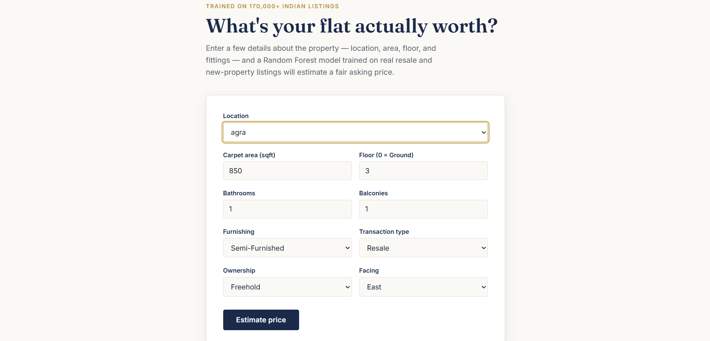
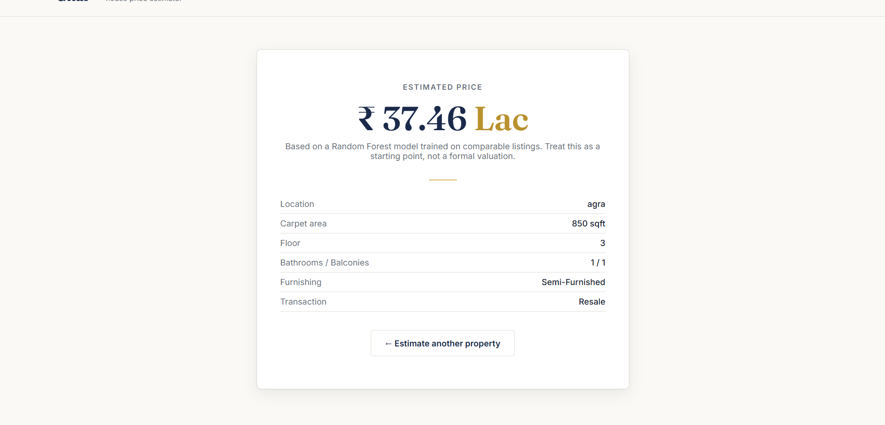

# Ghar — House Price Prediction (End-to-End ML Web App)

An end-to-end machine learning product that predicts the price of a residential property in
India from its location, area, floor, furnishing status, and a few other details. The project
covers the full pipeline: raw data → cleaning \& modeling in a Jupyter notebook → a FastAPI
backend serving the trained model → a React + TypeScript frontend where a user fills in a form
and gets a real-time price estimate.

> Built as a student project following the *House Price Prediction — Student Project Guide*.

\---

## Table of Contents

* [Overview](#overview)
* [Architecture](#architecture)
* [Tech Stack](#tech-stack)
* [Project Structure](#project-structure)
* [Dataset](#dataset)
* [Getting Started](#getting-started)

  * [Backend Setup](#backend-setup)
  * [Frontend Setup](#frontend-setup)
* [Environment Variables](#environment-variables)
* [API Reference](#api-reference)
* [Model Performance](#model-performance)
* [Screenshots](#screenshots)
* [Notes \& Known Limitations](#notes--known-limitations)

\---

## Overview

The dataset is a real, messy collection of \~187,000 property listings scraped from an Indian
real-estate site. The notebook cleans it (parsing free-text prices and areas, engineering
features, handling high-cardinality categoricals, removing outliers), trains and compares two
regression models, and exports the winning model as a single scikit-learn `Pipeline` — so the
backend needs no manual feature encoding at inference time.

**Winning model:** Random Forest Regressor, R² = 0.92 on a held-out test set (see
[Model Performance](#model-performance)).

## Architecture

```
┌─────────────────┐      HTTP POST /predict       ┌──────────────────┐      .predict()       ┌────────────────────┐
│  React Frontend  │  ──────────────────────────▶ │  FastAPI Backend │ ───────────────────▶ │  house_price.pkl   │
│  (Vite, :5173)   │ ◀──────────────────────────  │     (:8000)      │ ◀─────────────────── │  (sklearn Pipeline)│
└─────────────────┘      JSON {predicted_price}    └──────────────────┘                      └────────────────────┘
                                                            ▲
                                                            │ trained & exported by
                                                            │
                                                  ┌──────────────────────┐
                                                  │ house_price_model    │
                                                  │ .ipynb (notebook)    │
                                                  └──────────────────────┘
```

The notebook is a one-time, offline step: it cleans the raw Kaggle CSV, trains the model, and
exports `house_price.pkl` + `locations.json`. The backend loads that pickle once at startup and
serves predictions; the frontend is a thin form that calls the backend over HTTP.

## Tech Stack

|Layer|Technology|
|-|-|
|Data cleaning \& modeling|Python, pandas, scikit-learn, matplotlib, seaborn, Jupyter|
|Backend API|FastAPI, Pydantic v2, Uvicorn|
|Frontend|React 18, TypeScript, Vite, React Router|
|Testing|pytest + httpx (backend), Vitest + React Testing Library (frontend)|

## Project Structure

```
house-price-project/
├── notebooks/
│   ├── house_price_model.ipynb   # cleaning, EDA, training, evaluation, export
│   └── data/
│       └── house_prices.csv      # raw Kaggle dataset (not committed — see Dataset section)
├── backend/
│   ├── app/
│   │   ├── main.py                    # FastAPI app, CORS, lifespan model loading
│   │   ├── api/routes/prediction.py   # GET /health, POST /predict
│   │   ├── core/config.py             # settings from .env (pydantic-settings)
│   │   ├── schemas/prediction.py      # PredictionRequest / PredictionResponse
│   │   ├── services/
│   │   │   ├── preprocessing.py       # request -> one-row DataFrame
│   │   │   └── inference.py           # loads .pkl, runs predict
│   │   └── utils/logging_config.py
│   ├── models/
│   │   ├── house_price.pkl       # exported by the notebook
│   │   └── locations.json        # allowed location dropdown values
│   ├── tests/test_prediction.py
│   ├── requirements.txt
│   ├── .env.example
│   └── Dockerfile
└── frontend/
    ├── src/
    │   ├── api/predictionClient.ts
    │   ├── components/PredictionForm.tsx
    │   ├── pages/{HomePage,ResultPage,NotFoundPage}.tsx
    │   ├── types/prediction.ts
    │   ├── data/locations.json
    │   └── App.tsx
    ├── src/App.test.tsx           # integration tests (form fill -> submit -> result)
    ├── package.json
    ├── vite.config.ts
    └── .env.example
```

## Dataset

[**House Price**](https://www.kaggle.com/datasets/juhibhojani/house-price) by Juhi Bhojani
(Kaggle) — \~187,000 real property listings from India.

The raw CSV is **not committed** to this repository (it's \~100 MB). To reproduce the notebook:

**Option A — manual:** download from the link above, unzip, and place `house_prices.csv` in
`notebooks/data/`.

**Option B — Kaggle CLI:**

```bash
pip install kaggle
# Get an API token: Kaggle -> Settings -> API -> "Create New Token"
# Place kaggle.json in C:\Users\<you>\.kaggle\  (Windows) or ~/.kaggle/ (macOS/Linux)
kaggle datasets download -d juhibhojani/house-price -p notebooks/data --unzip
```

## Getting Started

Prerequisites: **Python 3.11+**, **Node.js 18+**, `pip`, `npm`.

### Backend Setup

```bash
cd backend
python -m venv .venv
.venv\Scripts\activate        # Windows
# source .venv/bin/activate   # macOS / Linux

pip install -r requirements.txt
cp .env.example .env          # or manually create .env with the same content

uvicorn app.main:app --reload
```

The API will be live at **http://localhost:8000**. Interactive docs (Swagger UI) at
**http://localhost:8000/docs**.

Run the backend tests:

```bash
pytest
```

### Frontend Setup

In a **second terminal** (leave the backend running):

```bash
cd frontend
npm install
cp .env.example .env          # or manually create .env with the same content

npm run dev
```

Open **http://localhost:5173**, fill in the form, and submit to get a live prediction.

Run the frontend tests:

```bash
npm test
```

## Environment Variables

**`backend/.env`**

|Variable|Description|Default|
|-|-|-|
|`MODEL_PATH`|Path to the exported `.pkl` pipeline|`models/house_price.pkl`|
|`CORS_ORIGINS_RAW`|Comma-separated list of allowed frontend origins|`http://localhost:5173`|

**`frontend/.env`**

|Variable|Description|Default|
|-|-|-|
|`VITE_API_BASE_URL`|Base URL of the FastAPI backend|`http://localhost:8000`|

## API Reference

### `GET /health`

```bash
curl http://localhost:8000/health
```

```json
{"status": "ok"}
```

### `POST /predict`

```bash
curl -X POST http://localhost:8000/predict \
  -H "Content-Type: application/json" \
  -d '{
    "location": "thane",
    "carpet_area_sqft": 850,
    "floor_num": 3,
    "bathroom": 2,
    "balcony": 1,
    "furnishing": "Semi-Furnished",
    "transaction": "Resale",
    "ownership": "Freehold",
    "facing": "East"
  }'
```

```json
{"predicted_price": 4612298.196340527}
```

An invalid request (e.g. `carpet_area_sqft <= 0` or a missing field) returns **HTTP 422** with
a Pydantic validation error body.

## Model Performance

Two models were trained on `log1p(price)` and evaluated on a 20% held-out test set
(see `notebooks/house_price_model.ipynb`, section 2.5):

|Model|MAE (₹)|RMSE (₹)|R²|
|-|-|-|-|
|Linear Regression (baseline)|3,483,227|6,494,641|0.638|
|**Random Forest (final model)**|**1,019,017**|**3,006,178**|**0.922**|

5-fold cross-validation on the Random Forest confirmed the result was not a lucky split:
**mean R² = 0.904 ± 0.005**.

Random Forest was selected as the final model: the relationship between features like
location, area, and furnishing and the final price is highly non-linear, which a tree ensemble
captures far better than a linear model.

*Trained with scikit-learn 1.8.0 — the backend's `requirements.txt` is pinned to the same
version, since a pickle only loads reliably with the exact version it was trained with.*

## Screenshots






Notes \& Known Limitations :

* Predictions are estimates from a model trained on historical listings, not a formal property
valuation.
* The `location` dropdown only includes the top 50 most common locations from training data
(everything else was grouped into `"other"` during training).

